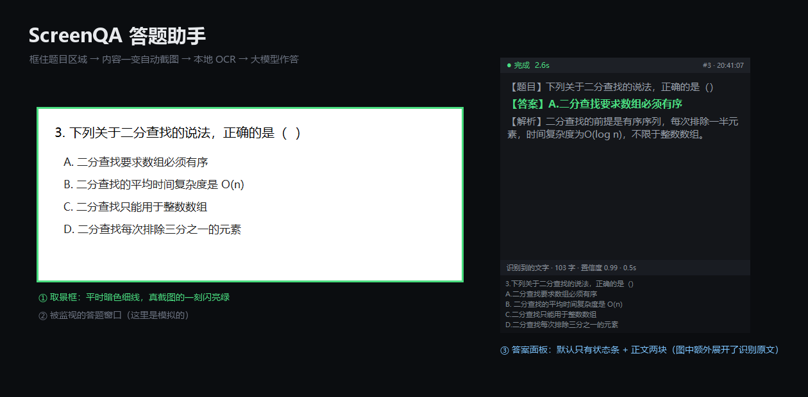
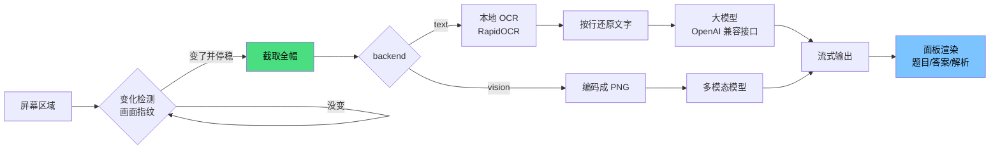
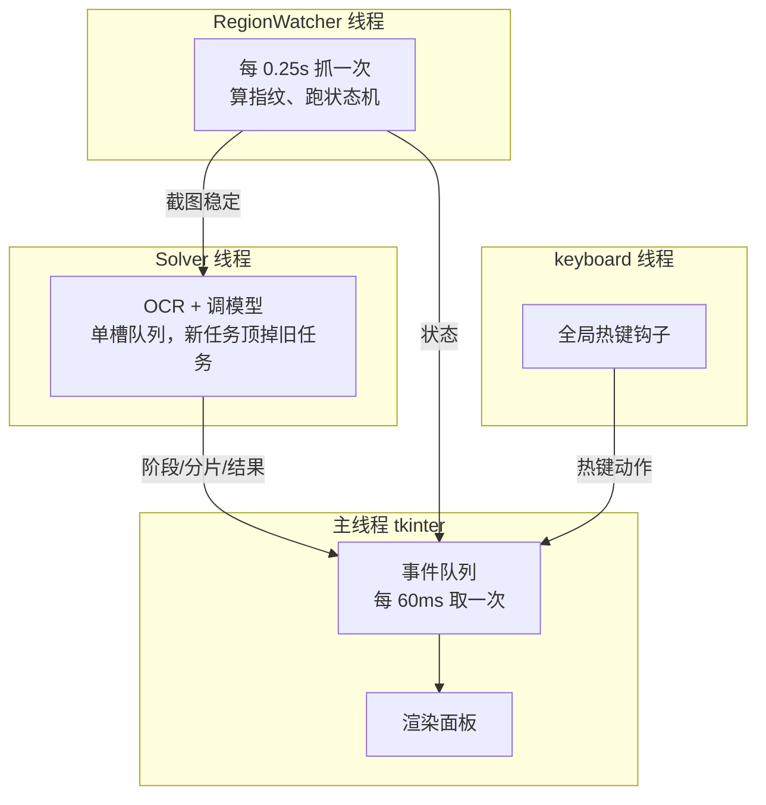
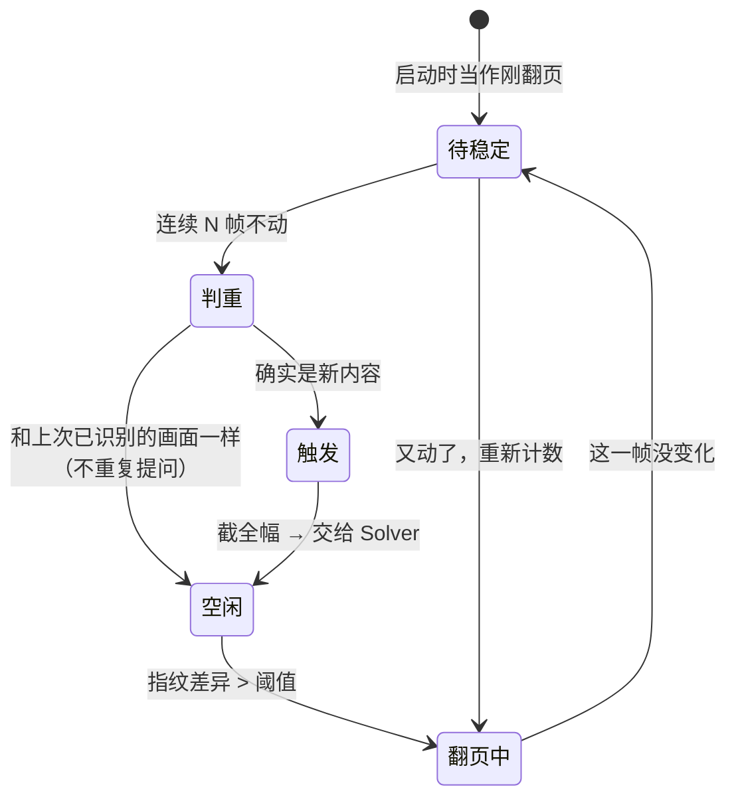
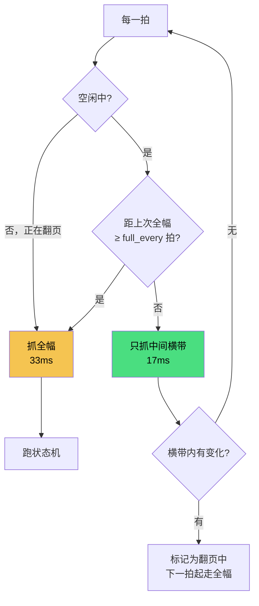
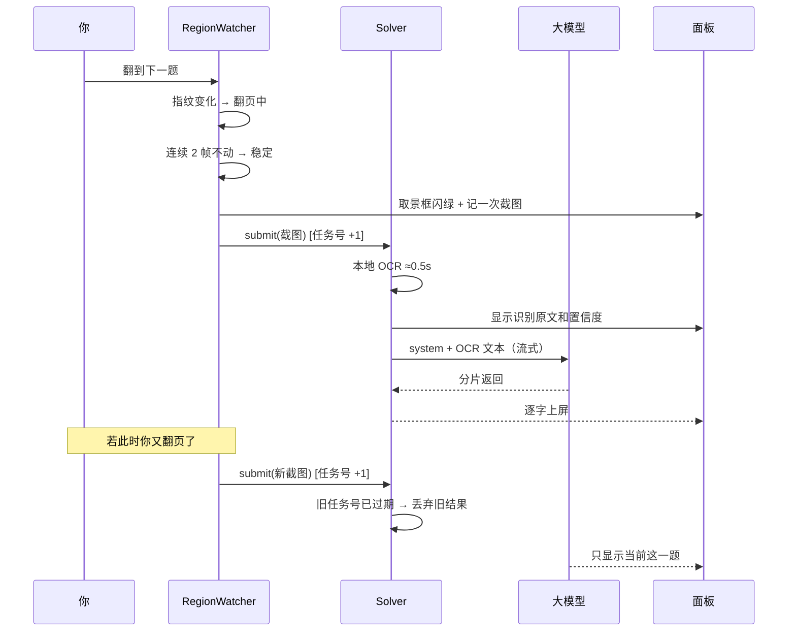

# ScreenQA 答题助手

**屏幕区域 OCR + 大模型自动答题** — 框住屏幕上一块区域，内容一变就自动截图、本地 OCR 识别、发给大模型作答。
翻题快慢随你，框选之后全程不用再碰这个程序。

*Screen-region OCR + LLM quiz solver. Frame an area once, it auto-captures on change, runs local OCR, and answers with an LLM.*

[](LICENSE)




---

## 目录

- [特性](#特性) · [快速开始](#快速开始) · [界面与热键](#界面与热键)
- [实现原理](#实现原理)（含流程图）· [性能](#性能)
- [配置](#配置) · [常见问题](#常见问题) · [English](#english)

## 特性

| | |
|---|---|
| **变化驱动** | 不是定时轮询模型，而是盯画面指纹。翻页停稳了才截图，停 2 秒还是 2 分钟都一样 |
| **本地 OCR** | RapidOCR（ONNX，自带中英文模型），只把识别出的**文字**发出去，截图不出本机 |
| **也支持多模态** | 改一行配置，截图直接发给视觉模型，公式题、图表题更准 |
| **任意兼容接口** | DeepSeek、Kimi、通义、本地 ollama，改 `base_url` 即可 |
| **固定输出** | 只回【题目】【答案】【解析】三段，不说废话 |
| **界面极简** | 默认只有一行状态条 + 答案正文两块，其余按需调出 |
| **低干扰** | 可点击穿透、可自动变淡、不占任务栏、不进 Alt+Tab |
| **截图可见** | 取景框在真截图那一刻闪绿，截图流水和 OCR 原文都可查 |

## 快速开始

```bash
git clone https://github.com/Thedan-1/ScreenQA-ocr-quiz-solver.git
cd ScreenQA-ocr-quiz-solver
pip install -r requirements.txt
python main.py
```

首次运行会自动从 `config.example.json` 生成 `config.json`，把 API key 填进去：

```json
"api": {
  "base_url": "https://api.deepseek.com",
  "api_key": "sk-你的密钥",
  "model": "deepseek-chat"
}
```

也可以留空 `api_key`，改用环境变量 `DEEPSEEK_API_KEY`。

> 程序**只**读 `api_key_env` 指定的那一个环境变量（默认 `DEEPSEEK_API_KEY`），
> 不会去捡 `OPENAI_API_KEY` 之类 —— 避免把一家的密钥发到另一家的服务器上。

启动后屏幕变暗，拖鼠标框出题目区域即可。

### 支持的模型

任何 OpenAI 兼容的 Chat Completions 接口：

| 服务 | `base_url` | `model` |
|------|-----------|---------|
| DeepSeek | `https://api.deepseek.com` | `deepseek-chat` |
| 月之暗面 Kimi | `https://api.moonshot.cn/v1` | `moonshot-v1-8k` |
| 通义千问 | `https://dashscope.aliyuncs.com/compatible-mode/v1` | `qwen-plus` |
| 本地 ollama | `http://localhost:11434/v1` | `qwen2.5:14b` |

想跳过 OCR、直接把截图交给多模态模型（需 `pip install anthropic`）：

```json
"backend": "vision",
"vision": { "model": "claude-sonnet-5" }
```

## 界面与热键

面板默认只有**两块**：一行状态条 + 答案正文。识别原文、热键条都收起来，需要时按键调出。

```
┌────────────────────────────────────┐
│ ● 完成 2.6s          #3 · 20:41:07 │  状态条：阶段 + 计数 + 时间
├────────────────────────────────────┤
│ 【题目】…                          │
│ 【答案】A. …          ← 绿色加粗   │  答案正文
│ 【解析】…                          │
└────────────────────────────────────┘
     （F6 展开识别原文 · F1 展开热键条）
```

| 键 | 作用 |
|----|------|
| `F1` | 显示 / 隐藏热键条 |
| `F3` | **只看答案** —— 隐藏题目和解析，只留答案 |
| `F4` | **点击穿透** —— 面板不再接收鼠标，点击直接穿到下面的程序（开启时拖不动面板）|
| `F6` | 显示 / 隐藏识别原文 |
| `F7` | 显示 / 隐藏答案面板 |
| `F8` | 暂停 / 继续监听（暂停后不做任何截屏动作）|
| `F9` | 立刻重新识别当前画面 |
| `F10` | 重新框选区域 |
| `F11` | 显示 / 隐藏取景框 |
| `F12` | 退出 |

面板还支持静置自动变淡（`fade_after`），有新答案时自动恢复。
窗口标记为工具窗口，不占任务栏、不出现在 Alt+Tab 列表里。

---

## 实现原理

### 总体数据流



三个后台线程 + 主线程，互不阻塞：



### 变化检测状态机

不定时问模型，而是判断"内容变了并且停稳了"：



具体参数：

- 每 **0.25s** 抓一次，压成 **64×64** 灰度矩阵当指纹
- 单像素亮度差 **> 12** 才算变化（滤掉抗锯齿、轻微重绘）
- 变化像素占比 **> 1.2%** 判定"正在翻页"
- 连续 **2 帧**不动才认为稳定
- 稳定后再和"上次已识别的画面"比一次，一样就不重复问

所以光标闪烁、鼠标划过会被滤掉；滚动、翻页动画、加载都算"正在动"，等它停。

### 两级采样：为什么不是每次都抓全幅

实测（区域 2247×1195）发现 `mss.grab` 有一个**约 16.6ms 的固定开销**，几乎正好是 1/60 秒
—— 卡在 Windows 桌面合成器的垂直同步上。面积只贡献另外约 16.5ms：

| 抓取高度 | 占全区面积 | 单次 grab |
|---------|-----------|----------|
| 1195 px | 100% | 33.1 ms |
| 600 px | 50% | 17.5 ms |
| 300 px | 25% | 16.5 ms |
| 20 px | 1.7% | 16.6 ms |

两个直接结论：

1. **抓小块最多省一半**，抓再小也降不下去
2. **抓多次反而更慢** —— 试过 3 条横带分别 grab，合计 53ms，比一次全幅还贵

所以空闲时只抓**中间一条 60% 高度的横带**（成本约 17ms，接近全幅的一半，但覆盖率远高于 1/3 带），
有动静或每隔 `full_every` 拍才抓全幅：



横带外的变化会被 `full_every` 的全幅兜底发现，最坏延迟 `full_every × poll_interval`（默认 2 秒）。
这条兜底路径有专门的回归测试覆盖：关掉兜底时确实检测不到，开启后能检测到。

### 一次问答的完整时序



### OCR 的行还原

RapidOCR 返回的是一堆带坐标的碎块，直接拼接会串行。所以按位置重排：

1. 每个碎块取包围盒中心的纵坐标 `cy` 和左边界 `x`
2. 按 `cy` 排序，用**行高的 60%** 作为容差把碎块聚成行（避免上下标、括号被拆到别的行）
3. 行内按 `x` 排序，用空格拼接；行与行用换行拼接

置信度低于 `min_confidence`（默认 0.5）的碎块直接丢弃。
区域较小时会先放大 `upscale` 倍再识别，小字准确率提升明显。

**OCR 一个字都没读到时不会发请求**，不浪费 token。

### 提示词与输出格式

system prompt 把格式钉死，模型只许回三段：

```
【题目】用一句话复述题目。多道题就分条写。
【答案】直接给答案。选择题写出选项字母和选项内容。
【解析】一到两句话说明为什么，不超过50字。
```

外加两条规则：不确定就给最可能答案并标 `(不确定)`；**画面里没题目时只回 `NO_QUESTION`**。

面板对 `NO_QUESTION` 做了流式拦截 —— 先攒够能判断的字符数再决定要不要上屏，
所以这个哨兵值永远不会一闪而过地出现在你眼前。

### 旧任务作废

Solver 是**单槽队列**：每次 `submit` 把任务号 +1，新截图直接顶掉还没开始的旧任务。
流式循环每收一个分片都检查一次任务号，过期就立刻退出，不再往面板上写。
所以上一题还没答完你就翻页，屏幕上不会出现两题混在一起。

---

## 性能

区域 2247×1195、每秒 4 拍，优化前后实测：

| 指标 | 优化前 | 优化后 |
|------|-------|-------|
| 每拍耗时 | 38.8 ms | **22.9 ms** |
| 单核占用 | 15.5% | **9.2%** |
| 指纹计算 | 11.3 ms（PIL 全尺寸→灰度→缩放）| **2.2 ms**（numpy 直接在 BGRA 缓冲区抽样）|

两处优化：

- **指纹算法**：不再构造完整 PIL 图像，直接用 `np.frombuffer` + `np.ix_` 在原始 BGRA
  缓冲区上抽样，快 5.3 倍。（注意累加要用 `uint32`，`255*256` 会溢出 `int16`）
- **两级采样**：空闲时只抓中间横带，见上文

第一次识别会慢一两秒（OCR 引擎加载，启动时已在后台预热），之后每次约 0.5 秒。

## 怎么知道它有没有截图

这类工具最让人不安的是"它到底什么时候在截我的屏"。所以截图行为三处同时可见：

| 信号 | 表现 |
|------|------|
| **屏幕上的取景框** | 监视区域周围一圈暗色细线常驻；**真正截图的那一刻闪亮绿加粗**。框内透明且点击穿透，不挡任何操作 |
| **状态条** | `● 已截图 660×268` + 右侧 `#3 · 20:41:07`（第几张、什么时候）|
| **识别原文（F6）** | 直接显示 OCR 读到的文字和置信度 —— 它到底截到了什么，你能亲眼看见 |

暂停（F8）后取景框变黄，程序不做任何截屏动作。

## 配置

| 字段 | 说明 |
|------|------|
| `backend` | `text` = 本地 OCR + 语言模型；`vision` = 截图直接给多模态模型 |
| `api.base_url` / `model` | OpenAI 兼容接口地址和模型名 |
| `api.api_key` | 密钥。留空则读 `api_key_env` 指定的环境变量 |
| `api.api_key_env` | 从哪个环境变量取密钥，默认 `DEEPSEEK_API_KEY` |
| `ocr.min_confidence` | 低于此置信度的识别结果丢弃，默认 0.5 |
| `ocr.upscale` | 小图放大倍数。小字识别不准时调到 3 |
| `region` | 框选区域。设为 `null` 会重新框选 |
| `answer_only` | 只显示【答案】（等同 F3）|
| `click_through` | 面板点击穿透（等同 F4）|
| `fade_after` / `fade_alpha` | 静置多少秒后变淡、淡到多少不透明度。0 = 不变淡 |
| `show_ocr_text` / `show_help` / `show_region_outline` | 各板块默认是否展开 |
| `diff_threshold` | 变化判定阈值。误触发多就调大，翻页识别不到就调小 |
| `stable_frames` | 连续几帧不动算稳定。页面动画长就调到 3~4 |
| `fast_probe` | 是否启用横带预检（省约 40% 开销）|
| `full_every` | 每隔几拍强制抓一次全幅兜底 |

`config.json` 已被 `.gitignore` 忽略（里面有密钥和你的屏幕坐标）。
编辑时请存成 **UTF-8 无 BOM**；存错了程序会在面板上明确提示，而不是默默用默认值。

## 常见问题

**识别不准？** 先按 F6 看识别原文。字太小就把 `ocr.upscale` 调到 3；区域框太大混进无关文字就缩小范围。

**一直不触发？** 区域里可能有视频、动图或跑动的进度条，会被当成"一直在翻页"。把框缩到只包住题干和选项。

**只有局部小改动检测不到？** 变化量低于 `diff_threshold`（默认 1.2%）会被当作噪声滤掉。
这是为了过滤光标闪烁的必要取舍，需要更灵敏就调小该值。

**公式题、图表题读不出来？** OCR 处理不了这类内容，把 `backend` 改成 `vision`。

**多显示器能用吗？** 可以，包括副屏在主屏左侧（负坐标）的情况。

## 项目结构

```
screenqa/
├── app.py        主程序：配置、事件循环、热键、状态机与界面的粘合
├── capture.py    截屏 + 变化检测状态机 + 两级采样
├── ocr.py        本地 OCR，按行还原文字
├── solver.py     两种后端、提示词、流式输出、旧任务作废
└── ui.py         框选遮罩 + 取景框 + 答案面板 + 点击穿透
```

## 环境

Windows 10/11，Python 3.8+。DPI 感知、全局热键、取景框透明、点击穿透都走 Windows API，其他系统未验证。

---

## English

**ScreenQA** watches a screen region you frame once. When the content changes and settles,
it captures the region, runs **local OCR** (RapidOCR — Chinese + English, ONNX, no PaddlePaddle/Torch),
and sends the recognized **text** to an LLM. Only text leaves your machine; the screenshot does not.

**How it works** — see the [flowcharts above](#实现原理). In short:

- A watcher thread samples the region 4×/s and compares a 64×64 grayscale fingerprint.
  A capture fires only when the content changed *and* then held still for 2 frames.
- `mss.grab` has a ~16.6 ms floor (one compositor frame), so idle ticks grab only a
  60%-height middle band (~17 ms) and fall back to a full grab every N ticks.
  Measured: 38.8 → 22.9 ms per tick, 15.5% → 9.2% of one core.
- The solver is a single-slot queue: a new capture supersedes the in-flight one, so
  flipping pages mid-answer never mixes two questions on screen.

**Features**: any OpenAI-compatible endpoint (DeepSeek, Moonshot, Qwen, local ollama);
optional `vision` backend for diagrams and formulas; fixed three-part output;
two-block minimal UI; click-through, auto-fade, no taskbar entry; capture activity
visible in three places at once.

```bash
pip install -r requirements.txt
python main.py     # or: python -m screenqa
```

Put your key in `config.json` (`api.api_key`) or in the `DEEPSEEK_API_KEY` environment variable.
The program reads **only** the env var named by `api_key_env` — it never falls back to
`OPENAI_API_KEY`, so a key for one vendor is never sent to another.

## 使用须知 / Disclaimer

本项目是屏幕 OCR 与大模型调用的技术实践，适合用于自动化流程测试、资料速查、学习辅助。
请勿用于正式考试、认证测评等明确禁止外部辅助的场合 —— 是否合规由使用者自行判断并承担责任。

*This is a technical demo of screen OCR + LLM integration, intended for automation testing,
quick reference, and study support. Do not use it in exams, certifications, or any setting
where outside assistance is prohibited. Compliance is the user's responsibility.*

## 关键词

自动答题 · 答题助手 · 屏幕识别 · 截图识别 · OCR 答题 · 题目识别 · AI 答题 · 大模型答题 · DeepSeek
screen ocr · quiz solver · auto answer · screenshot ocr · llm question answering · rapidocr · python tkinter

## License

[MIT](LICENSE)
